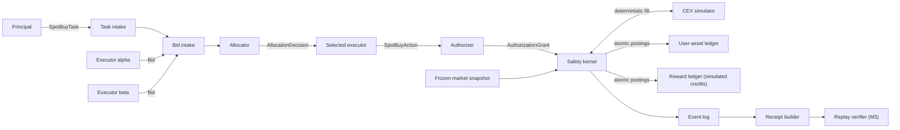

# OpenEM-01 M1: Verifiable Agent Execution — Architecture Assessment and Contract

- **Status:** proposed — draft for review (M1 only)
- **Date:** 2026-11-23
- **Issue:** [#4 — Epic: OpenEM-01 Verifiable Agent Execution](https://github.com/Domin-Focus/execution-market-research/issues/4)
- **Decision record:** [ADR-0001: OpenEM execution boundaries](decisions/0001-openem-execution-boundaries.md)
- **Scope:** architecture contract only. This document does not implement the workflow, and no M2 code is included.

## 1. Purpose and review gate

OpenEM-01 asks for the first end-to-end simulated execution workflow:

> A user submits **Buy BTC using 100 USDT, with maximum slippage of 0.5%**. OpenEM must allocate the task to an eligible executor, independently authorize the financial action, execute it in a deterministic CEX simulator, settle the resulting balances, and produce an auditable execution receipt.

The M1 deliverable is a contract:

1. inspect the existing repository;
2. define the minimum reusable interfaces;
3. define the execution state machine and its invariants;
4. define an implementation plan for M2 and evaluation boundaries for M3.

M2 begins only after this assessment and [ADR-0001](decisions/0001-openem-execution-boundaries.md) are reviewed. Until then, every interface, rule, and layout below is a **proposal**, not a description of existing behavior. Observations about the current repository are labelled as observations; proposed design choices are marked as such.

The workflow in this document is deliberately narrower than a trading system. It is a research instrument for demonstrating that allocation, authorization, financial state change, settlement, and evidence can be separated and replayed.

## 2. Repository inspection

### 2.1 Observed state on 2026-11-23

The repository is the Execution Market Research (EMR) durable record plus a public static website. There is no OpenEM runtime, package, database schema, or execution engine in the repository today.

| Area | Path | Observation | Relevance to OpenEM |
| --- | --- | --- | --- |
| Research process | [`README.md`](../README.md), [`GOVERNANCE.md`](../GOVERNANCE.md), [`BACKLOG.md`](../BACKLOG.md), [`CONTRIBUTING.md`](../CONTRIBUTING.md) | Questions, evidence labels, promotion rules, and one-question-per-issue discipline are defined. | OpenEM must stay traceable to an issue and decisions, not become an untracked implementation. |
| Receipt schema | [`specifications/execution-receipt-v0.1.md`](../specifications/execution-receipt-v0.1.md) | A generic `emr-receipt/0.1` envelope exists as a working draft. It has task, agent, authority, execution, evaluation, settlement, and signature fields. | Reuse as the receipt envelope; OpenEM needs a profile with allocation, authorization, order, ledger, and replay evidence. |
| Agent identity | [`agents/9481/agent-9481.json`](../agents/9481/agent-9481.json) | ERC-8004 Agent `9481` is registered on Ethereum Sepolia. The same metadata is served from the site. | Reuse the identity reference format for one executor; no on-chain writes are needed for M2. |
| Deterministic prototype | [`site/app/agent-9481/AgentLab.tsx`](../site/app/agent-9481/AgentLab.tsx) | A browser-side fixed risk policy, canonical JSON helper (`stableStringify`), SHA-256 helper, and receipt-shaped output. | Reuse the canonicalization/hashing conventions and receipt-building pattern; the browser is not a trust boundary for financial execution. |
| Website | [`site/`](../site/) | Next.js 16 static export with a Cloudflare `vinext` worker and an empty Drizzle schema. No server-side domain logic, no persistence in use. | Presentation only. A static/browser runtime must not host the safety kernel or authoritative ledger. |
| Execution records | [`research/executions/9481/README.md`](../research/executions/9481/README.md) | Receipts may be committed only after review of snapshot, schema, authority, evaluation status, and secrets. | Reuse as the admission rule for OpenEM receipts; M2 output is not durable evidence until reviewed. |
| ADR process | [`architecture/decisions/README.md`](decisions/README.md) | Template and trigger conditions exist; no ADR exists in `main` at the time of inspection. | Use ADR-0001 for the boundary decisions in this assessment. |
| Specifications | [`specifications/`](../specifications/) | Only the receipt v0.1 draft exists. | The M1 contract stays in the assessment until review; a normative spec is promoted in M2. |
| Tests and CI | [`site/tests/rendered-html.test.mjs`](../site/tests/rendered-html.test.mjs), [`.github/workflows/pages.yml`](../.github/workflows/pages.yml) | One static rendering test and a Pages deployment workflow. No core-logic tests or general CI. | M2 needs its own test command and CI; the site workflow is not a substitute. |
| Database | [`site/db/schema.ts`](../site/db/schema.ts) | Intentionally empty. | Do not introduce D1 into the deterministic core. Persistence can be an adapter in M3 if needed. |

Two observations matter most:

1. **There is no existing OpenEM implementation to extend.** "Reuse existing components instead of building a parallel framework" therefore means reusing the receipt schema, identity metadata, canonicalization/hashing behavior, execution-record review rules, and ADR governance. It cannot mean reusing an existing execution framework, because none exists here.
2. **The only executable code is the static site.** It is a rendering and demonstration surface. Financial authorization and ledger mutation cannot live in browser code or in a static export that a client controls.

### 2.2 Capability gap against the required workflow

| Workflow stage | Existing support | Gap for M2 |
| --- | --- | --- |
| Task | Research issues and experiment docs describe tasks; the Agent Lab hard-codes a risk task. | Typed, content-addressed task schema with a principal, amount, pair, slippage bound, and deadlines. |
| Bidding | None. | Executor manifests, typed bid submission, eligibility rules, and bid verification. |
| Allocation | Experiment 001 names selection policies; no executable allocator. | Deterministic allocation over eligible bids, with a recorded decision and no spending authority. |
| Authorization | The receipt records an authority hash/expiry; the Agent Lab records a descriptive simulation-only policy. | An independent authorizer that issues a scoped, single-use grant bound to a typed action. |
| Safety validation | A browser risk policy is deterministic but is not a financial kernel. | A safety kernel with explicit invariants, pure validation, and atomic commit. |
| Execution | None. | A deterministic CEX simulator over frozen order-book snapshots. |
| Settlement | None. | User-asset ledger postings that reconcile with the simulated order. |
| Rewards | None. | A separate simulated-credit ledger for executor compensation. |
| Receipt | A generic envelope without workflow evidence. | An OpenEM profile with bids, allocation, grant, order, postings, rewards, and replay status. |
| Replay | None. | Deterministic inputs and hashes that allow a bit-identical rerun. |

### 2.3 Assessment against the epic's architectural principles

| Principle | Current state | Contract response |
| --- | --- | --- |
| Preserve the execution-market abstraction | Present in EMR prose; not executable. | Keep task, bid, executor, allocation, authorization, execution, settlement, and receipt as distinct domain objects. Do not collapse them into one "trade service". |
| Reuse existing components | EMR receipt, Agent 9481 metadata, canonical hashing, and governance exist. | Reuse them through an OpenEM receipt profile, a byte-compatible canonicalizer, the existing identity format, and the existing review process. |
| Keep market allocation separate from financial authorization | Not implemented. | Separate modules with separate inputs and outputs; an allocation decision cannot create or widen a grant. |
| Treat agent and executor outputs as untrusted | The Agent Lab is trusted local code; there is no external-output boundary. | Bids, action proposals, claimed capabilities, and claimed quality are validated structurally and semantically. No `eval`, no network resolution, and never read authorization scope from a bid. |
| Route all financial state changes through a deterministic safety kernel | No financial state exists yet. | `SafetyKernel.commit` is the only mutator of user-asset and reward ledgers; validation is pure; commit revalidates and is atomic. |
| Keep executor rewards separate from user asset accounting | No rewards exist. | A separate simulated-credit ledger with no conversion path into user balances. |
| Never integrate real exchanges or real funds | The site is simulation-only; no exchange code exists. | Frozen fixtures only, integer arithmetic, no network, no wallets, no credentials. |
| Produce an auditable receipt | An envelope exists but is unsigned and lacks workflow fields. | Hash-bound event log, inputs/outputs/actions hashes, full workflow evidence, and a verifier; signatures are explicitly deferred. |
| Replay deterministically | None. | Injected clock, content-derived identifiers, sorted iteration, integer math, and replay bundles. |

### 2.4 Reuse map

| Existing artifact | How M2 reuses it | Deliberate change |
| --- | --- | --- |
| `emr-receipt/0.1` | Remains the receipt envelope. OpenEM adds `profile: "openem-execution/0.1"` and an `openem` extension block. | No edit to the existing specification in M1. A future EMR-001 revision can absorb the extension if it becomes generally useful. |
| Agent Lab `stableStringify` and `sha256` | Extract equivalent canonical JSON and hashing behavior into the core package; add a golden test against an Agent Lab receipt fixture. | Core uses `node:crypto` for synchronous hashing; the browser helper remains for the site. |
| ERC-8004 Agent `9481` | Executor `alpha` identity reference. | No registration transaction and no metadata change. |
| `agents/` metadata | Cross-check executor identity fields. | A second executor uses a clearly labelled research-only identity fixture. |
| `research/executions/9481` admission rule | Apply the same review discipline to OpenEM receipts. | Add OpenEM-specific checks for grant, order, ledger, and reward evidence. |
| ADR template | Record the decisions in ADR-0001. | None. |
| Site and static-export stack | Remain presentation. Future receipt viewers may import read-only types. | No kernel, ledger, or authorization code in `site/`. |
| `node:test` | Use the same minimal runtime test style. | A dedicated package test command and CI job. |
| GOVERNANCE labels | Mark the M1 document as proposed; record observations separately from proposals. | None. |

### 2.5 Non-goals for M1

- No runtime code, package scaffolding, or test harness.
- No changes to `site/`, the D1 schema, or the deployed website.
- No edits to `specifications/execution-receipt-v0.1.md`.
- No M2 implementation, no smart-contract work, no ERC-8004 writes.
- No real exchange API, funds, wallets, signing keys, payment rails, or credentials.

## 3. Target architecture

### 3.1 Component map



The selected executor is an untrusted proposer. The allocator chooses it, but the authorizer and kernel do not trust its action merely because it was selected.

### 3.2 Component responsibilities

| Component | Responsibility | Must not do |
| --- | --- | --- |
| Task intake | Validate the task, bind it to a principal and an account, hash the specification, and open the bidding window. | Move funds or decide eligibility of an executor. |
| Executor registry | Provide operator-curated manifests: identity, supported capability, venues, fee schedule, active flag. | Take capability claims from bids or action payloads. |
| Bid intake | Validate bid structure, task hash, deadline, executor status, and duplicate identifiers. | Choose a winner or authorize spending. |
| Allocator | Filter eligible bids, apply a deterministic scoring rule, and emit one allocation decision. | Issue a grant, touch a ledger, or learn the selected executor's eventual action. |
| Executor (untrusted) | Submit a bid and, once selected, propose a typed action. | Read ledgers, write ledgers, alter manifests, or define authority. |
| Authorizer | Independently decide whether a typed action is within the principal's mandate; issue a scoped, expiring, single-use grant. | Choose the executor, change the allocation, or mutate a ledger. |
| Safety kernel | Revalidate the grant and action against authoritative state, invoke the simulator, compute postings, assert invariants, and atomically commit. | Trust cached validation results or accept an altered invariant set from an agent. |
| CEX simulator | Produce a deterministic fill from a frozen order book and typed action. | Use live data, network access, or wall-clock time. |
| User-asset ledger | Hold principal and venue balances in available/reserved buckets. | Receive writes from anything other than the kernel. |
| Reward ledger | Hold simulated executor credits in a separate namespace. | Convert credits to user assets or be reconciled as if it were user money. |
| Receipt builder/verifier | Compose the EMR receipt profile, hash the event log, and detect tampering. | Add or change execution facts after settlement. |
| Replay verifier (M3) | Rerun a receipt from its recorded inputs and compare hashes. | Apply replay output to the authoritative ledger. |
| Runtime adapters | Load fixtures, provide a fixture clock, expose a CLI. | Introduce nondeterminism into the core. |

### 3.3 Trust boundaries

| Boundary | Classification | Rule |
| --- | --- | --- |
| Core code, invariant set, venue configuration, committed fixtures, allocation/authorization policy versions | Trusted (reviewed in this repository) | Changes require review; policy hashes are recorded in the receipt. |
| Executor manifests in the registry | Operator-curated, semi-trusted | Treated as configuration, never as a bid field. Capabilities are matched against the task. |
| Bids and action proposals | Untrusted | Schema validation, task/deadline binding, scope checks, and kernel revalidation. |
| Claimed executor quality, fee advantage, or capability in free text | Untrusted | Not parsed for authority; only typed fields with reviewed semantics are used. |
| Receipts received from outside | Untrusted evidence | `verify` recomputes hashes and schema; it does not execute embedded content. |
| Frozen market snapshot | Operator-curated fixture, content-addressed | Hash bound into the authorization grant; mismatch rejects execution. |
| Real exchange, real wallet, payment network | Out of scope | Must be absent from the execution path. |

Additional boundary rules:

- No agent-supplied string is evaluated as code, shell, SQL, or a template.
- No network call occurs between authorization and commit. The only market input is the frozen snapshot whose hash is in the grant.
- A manifest is looked up by executor ID from the registry; a bid cannot smuggle in a new manifest or capability.
- The reward ledger is not reachable from the user-asset posting path. Cross-ledger postings are an invariant violation.

### 3.4 Runtime placement

**Proposal:** add a framework-agnostic TypeScript package under `openem/` in this repository. It runs on Node.js 22, has no runtime dependencies, and exposes a CLI for the M2 demonstration. The site remains a separate presentation artifact.

This is not a second framework. It is the first OpenEM runtime; the existing receipt, identity, hashing, and review artifacts are inputs to it. The package boundary exists to keep the deterministic core reviewable and free of site, database, and deployment concerns.

Why not implement inside `site/`:

- the site is a static export; a client can modify browser code and local state;
- the trusted kernel and ledger must run in a controlled process with reviewed code, not in a client;
- the site's Cloudflare/`vinext` worker and D1 binding are persistence/runtime choices that would add nondeterminism and coupling to the financial core;
- the existing site has no server-side logic or domain tests.

Why not a separate repository in M1:

- the epic targets this repository;
- the receipt schema, identity metadata, canonicalization conventions, and review process live here;
- a new package can stay isolated without fragmenting the research record.

The site may later import read-only receipt types to display verified evidence. It must not import the kernel, authorizer, or ledger mutators.

### 3.5 Determinism rules

These rules apply to everything that can affect a committed hash:

1. **Canonical JSON** — keys sorted, UTF-8 bytes, no `undefined`, no functions, no `NaN`/`Infinity`, no floating-point amounts. The canonicalizer must match the Agent Lab helper for the fixture shapes both use.
2. **Hashing** — SHA-256 over canonical bytes; lowercase `0x`-prefixed hex. The same value hashed in the browser and Node must produce the same digest.
3. **Amounts** — integer minor units as decimal strings at boundaries; `bigint` internally. BTC uses 8 decimals, USDT uses 6. Rounding direction is always floor unless a rule states otherwise, and any remainder stays in an explicitly named account.
4. **Time** — a `Clock` port supplies all timestamps. M2 uses a fixture clock. The core must not call `Date.now()` or `new Date()` for hashed fields. Replay uses the timestamps recorded in the bundle.
5. **Identifiers** — derived from canonical content or supplied by reviewed fixtures. No `crypto.randomUUID()`, no unseeded randomness.
6. **Ordering** — collection order is canonical (sorted by a stated key), never JavaScript insertion order or object iteration order.
7. **Isolation** — no network, no environment-dependent branches, no secrets, no filesystem reads inside pure validation. Fixture loading happens at the adapter boundary.
8. **Versioning** — kernel, allocation rule, authorization policy, venue config, task type, and invariant set each carry a version; the versions are hashed into the receipt inputs.

## 4. Minimum reusable interfaces

The interfaces below are the review surface for M2. They are normative for field meaning and trust rules; exact file placement and internal helper names may change during implementation without changing the contract.

### 4.1 Conventions

```ts
/** Lowercase, 0x-prefixed SHA-256 over canonical JSON bytes. */
export type Hash = `0x${string}`;

/** ISO-8601 UTC timestamp, supplied by an injected clock. */
export type IsoTimestamp = string;

/** Unsigned fixed-point integer encoded as a decimal string. */
export type MinorUnits = string;

/** Account identifier, e.g. "acct:user-alpha". */
export type AccountId = string;

/** ERC-8004 reference or a labelled research-only fixture id. */
export type ExecutorId = string;
```

The initial assets are:

```ts
export interface AssetDefinition {
  readonly symbol: "BTC" | "USDT";
  readonly decimals: 8 | 6;
}
```

All arithmetic in the kernel and simulator uses `bigint`; the decimal-string boundary prevents JSON precision loss and accidental float use.

### 4.2 Task, executor, and bid contracts

```ts
export interface SpotBuyTask {
  readonly version: "openem.task.spot-buy/0.1";
  readonly taskId: string;
  readonly principal: AccountId;
  readonly venue: string;
  readonly baseAsset: "BTC";
  readonly quoteAsset: "USDT";
  readonly side: "buy";
  /** Notional quote budget, excluding venue fee. 100 USDT = "100000000". */
  readonly quoteAmountMinor: MinorUnits;
  /** 50 = 0.5%. */
  readonly maxSlippageBps: number;
  /** The reference is resolved from the authorization snapshot, not chosen by the executor. */
  readonly referencePriceRule: "best-ask-at-authorization/0.1";
  readonly biddingDeadline: IsoTimestamp;
  readonly executionDeadline: IsoTimestamp;
}

export interface ExecutorManifest {
  readonly version: "openem.executor/0.1";
  readonly executorId: ExecutorId;
  /** ERC-8004/CAIP reference, or "research:..." for a non-registered fixture. */
  readonly identity: string;
  readonly capabilities: readonly ("spot.buy")[];
  readonly venues: readonly string[];
  readonly feeScheduleBps: number;
  readonly active: boolean;
}

export interface Bid {
  readonly version: "openem.bid/0.1";
  readonly bidId: string;
  readonly taskId: string;
  readonly taskSpecHash: Hash;
  readonly executorId: ExecutorId;
  /** Allocation signal only. It is not a source of financial authority. */
  readonly feeBps: number;
  readonly submittedAt: IsoTimestamp;
  readonly expiresAt: IsoTimestamp;
  readonly nonce: string;
  /** null in M2; a future signature must not be treated as authorization. */
  readonly signature: string | null;
}
```

A bid is eligible only when its schema is valid, `taskSpecHash` matches the task, `expiresAt` and the task bidding deadline have not passed, the executor exists, is active, supports `spot.buy`, supports the task venue, the bid `feeBps` equals the reviewed manifest's `feeScheduleBps`, and the bid identifier is unique. The `feeBps` is the only scored field in M2; self-declared slippage or quality claims are not accepted.

### 4.3 Allocation contract

```ts
export type RejectionCode =
  | "TASK_INVALID"
  | "TASK_EXPIRED"
  | "BID_INVALID"
  | "BID_TASK_MISMATCH"
  | "BID_EXPIRED"
  | "EXECUTOR_INELIGIBLE"
  | "NO_ELIGIBLE_BID"
  | "ACTION_INVALID"
  | "ACTION_OUT_OF_SCOPE"
  | "AUTHORIZATION_DENIED"
  | "AUTHORIZATION_EXPIRED"
  | "AUTHORIZATION_REUSED"
  | "INSUFFICIENT_BALANCE"
  | "GRANT_ACTION_MISMATCH"
  | "MARKET_SNAPSHOT_MISMATCH"
  | "ORDER_UNFILLED"
  | "SLIPPAGE_EXCEEDED"
  | "LEDGER_IMBALANCE"
  | "DUPLICATE_SUBMISSION"
  | "KERNEL_INVARIANT_VIOLATION";

export interface AllocationDecision {
  readonly version: "openem.allocation/0.1";
  readonly allocationId: string;
  readonly taskId: string;
  readonly taskSpecHash: Hash;
  readonly bidsHash: Hash;
  readonly eligibleBidIds: readonly string[];
  readonly rejectedBids: readonly {
    readonly bidId: string;
    readonly code: RejectionCode;
    readonly detail: string;
  }[];
  readonly selectedBidId: string;
  readonly selectedExecutorId: ExecutorId;
  readonly rule: "lowest-fee-then-bid-hash/0.1";
  readonly decidedAt: IsoTimestamp;
}

export interface Allocator {
  allocate(input: {
    readonly task: SpotBuyTask;
    readonly taskSpecHash: Hash;
    readonly bids: readonly Bid[];
    readonly manifests: readonly ExecutorManifest[];
    readonly now: IsoTimestamp;
  }): AllocationDecision;
}
```

The M2 rule is intentionally simple and inspectable: lowest `feeBps`, then lexicographically smallest `bidId` as the tie-break. The allocator receives no ledger, no grant, and no action. An empty eligible set produces a terminal `NO_AWARD`; it must not synthesize a bid or reuse a previous allocation.

### 4.4 Action and authorization contracts

```ts
export interface SpotBuyAction {
  readonly version: "openem.action.spot-buy/0.1";
  readonly actionId: string;
  readonly taskId: string;
  readonly taskSpecHash: Hash;
  readonly allocationId: string;
  readonly executorId: ExecutorId;
  readonly venue: string;
  readonly baseAsset: "BTC";
  readonly quoteAsset: "USDT";
  readonly side: "buy";
  /** Must be <= the task quote budget and the grant cap; equals the task amount for M2's full-buy task. */
  readonly maxQuoteSpendMinor: MinorUnits;
  /** Must be <= the task and grant slippage limit. */
  readonly maxSlippageBps: number;
  /** Chosen from the reviewed fixture registry, not from a URL. */
  readonly marketSnapshotId: string;
  /** Idempotency key for the eventual kernel commit. */
  readonly clientOrderId: string;
  readonly createdAt: IsoTimestamp;
}

export interface AuthorizationContext {
  readonly task: SpotBuyTask;
  readonly taskSpecHash: Hash;
  readonly allocation: AllocationDecision;
  readonly executor: ExecutorManifest;
  readonly action: SpotBuyAction;
  /** Resolved by the trusted fixture registry from action.marketSnapshotId. */
  readonly market: MarketSnapshot;
  /** Reviewed venue configuration for fee and inventory checks. */
  readonly venue: VenueConfig;
  readonly ledger: LedgerSnapshot;
  readonly now: IsoTimestamp;
}

export interface AuthorizationGrant {
  readonly version: "openem.authorization.grant/0.1";
  readonly grantId: string;
  readonly principal: AccountId;
  readonly taskId: string;
  readonly taskSpecHash: Hash;
  readonly allocationId: string;
  readonly executorId: ExecutorId;
  readonly actionHash: Hash;
  readonly venue: string;
  readonly baseAsset: "BTC";
  readonly quoteAsset: "USDT";
  readonly side: "buy";
  readonly maxQuoteSpendMinor: MinorUnits;
  readonly maxSlippageBps: number;
  readonly marketSnapshotId: string;
  readonly marketSnapshotHash: Hash;
  /** Resolved from the snapshot's best ask at authorization time. */
  readonly referencePriceQuoteMinorPerBase: MinorUnits;
  readonly expiresAt: IsoTimestamp;
  readonly nonce: string;
  readonly policyVersion: "openem.authorization-policy/0.1";
  readonly issuedAt: IsoTimestamp;
}

export type AuthorizationDecision =
  | { readonly outcome: "approved"; readonly grant: AuthorizationGrant }
  | {
      readonly outcome: "denied";
      readonly code: RejectionCode;
      readonly detail: string;
    };

export interface Authorizer {
  decide(context: AuthorizationContext): AuthorizationDecision;
}
```

The authorizer checks, at minimum:

1. the action schema is valid and belongs to the allocated task and executor;
2. the action pair, side, venue, spend cap, and slippage are within the task; for the M2 spot-buy task, `maxQuoteSpendMinor` must equal the task's `quoteAmountMinor` so a full task cannot silently become a partial buy;
3. the action's `marketSnapshotId` resolves to a reviewed snapshot for the venue, the snapshot was captured after task intake, and it is not older than the reviewed freshness policy;
4. the principal has enough available USDT for the notional, and the venue has enough BTC inventory to fill it after the base-asset fee;
5. the proposed grant is scoped, expiring, single-use, and its nonce is unused;
6. the action hash is computed from the exact action; later changes invalidate the grant.

The authorizer is pure. It does not reserve funds. In M2 the kernel performs the atomic debit/credit at commit. Reservation and concurrency control are M3 work; see §8.

### 4.5 Market and simulator contracts

```ts
export interface OrderBookLevel {
  /** Quote minor units per one whole base asset. $100,000 = "100000000000". */
  readonly priceQuoteMinorPerBase: MinorUnits;
  /** Base minor units available at this level. */
  readonly quantityBaseMinor: MinorUnits;
}

export interface MarketSnapshot {
  readonly version: "openem.market-snapshot/0.1";
  readonly snapshotId: string;
  readonly venue: string;
  readonly symbol: "BTC/USDT";
  readonly capturedAt: IsoTimestamp;
  readonly asks: readonly OrderBookLevel[];
  readonly bids: readonly OrderBookLevel[];
}

export interface VenueConfig {
  readonly version: "openem.venue/0.1";
  readonly venue: string;
  readonly symbol: "BTC/USDT";
  /** Venue fee charged in the received base asset. */
  readonly tradingFeeBps: number;
  /** Simulated-credit reward rate, separate from user assets. */
  readonly rewardBps: number;
  readonly enabled: boolean;
}

export interface FillResult {
  readonly status: "filled" | "rejected";
  readonly orderId: string;
  readonly filledBaseMinor: MinorUnits;
  readonly filledQuoteMinor: MinorUnits;
  /** Rational VWAP, rendered as a decimal string for evidence only. */
  readonly vwapQuoteMinorPerBase: MinorUnits;
  readonly feeBaseMinor: MinorUnits;
  readonly levelsConsumed: number;
  readonly rejection: {
    readonly code: RejectionCode;
    readonly detail: string;
  } | null;
}

export interface CexSimulator {
  execute(input: {
    readonly action: SpotBuyAction;
    readonly market: MarketSnapshot;
    readonly venue: VenueConfig;
  }): FillResult;
}
```

The simulator is a pure function. It walks asks in ascending price order, consumes at most the requested quote budget, and returns a full fill or a rejection. M2 uses **full-fill-or-reject**: partial liquidity, an empty book, an unsorted book, an invalid level, or a price bound breach does not produce a smaller fill. This keeps the ledger reconciliation and the safety invariant simple. Partial fills are an explicit M3-or-later extension, not an implied behavior.

### 4.6 Ledger and kernel contracts

```ts
export interface LedgerBalance {
  readonly account: AccountId;
  readonly asset: "BTC" | "USDT";
  readonly availableMinor: MinorUnits;
  readonly reservedMinor: MinorUnits;
}

export interface LedgerSnapshot {
  readonly version: "openem.ledger/0.1";
  readonly sequence: number;
  readonly balances: readonly LedgerBalance[];
}

export interface LedgerPosting {
  readonly account: AccountId;
  readonly asset: "BTC" | "USDT";
  readonly bucket: "available" | "reserved";
  /** Signed integer; negative debits, positive credits. */
  readonly deltaMinor: MinorUnits;
  readonly reason:
    | "trade-debit"
    | "trade-credit"
    | "venue-fee"
    | "venue-clearing-credit"
    | "venue-inventory-debit"
    | "authorization-reserve"
    | "authorization-release";
}

export interface RewardLedgerSnapshot {
  readonly version: "openem.reward-ledger/0.1";
  readonly sequence: number;
  readonly credits: readonly {
    readonly executorId: ExecutorId;
    readonly simCreditsMinor: MinorUnits;
  }[];
}

export interface RewardPosting {
  readonly executorId: ExecutorId;
  readonly deltaSimCreditsMinor: MinorUnits;
  readonly reason: "execution-reward";
  readonly reference: string;
}

export interface ExecutionContext {
  readonly task: SpotBuyTask;
  readonly taskSpecHash: Hash;
  readonly allocation: AllocationDecision;
  readonly action: SpotBuyAction;
  readonly actionHash: Hash;
  readonly grant: AuthorizationGrant;
  readonly grantHash: Hash;
  readonly market: MarketSnapshot;
  readonly marketHash: Hash;
  readonly venue: VenueConfig;
  readonly ledger: LedgerSnapshot;
  readonly rewardLedger: RewardLedgerSnapshot;
  readonly now: IsoTimestamp;
  /** Monotonic attempt number; part of the idempotency key. */
  readonly attempt: number;
}

export type CommitResult =
  | {
      readonly ok: true;
      readonly order: FillResult;
      readonly postings: readonly LedgerPosting[];
      readonly rewardPostings: readonly RewardPosting[];
      readonly ledgerBeforeHash: Hash;
      readonly ledgerAfterHash: Hash;
      readonly rewardLedgerBeforeHash: Hash;
      readonly rewardLedgerAfterHash: Hash;
      readonly committedAt: IsoTimestamp;
    }
  | {
      readonly ok: false;
      readonly code: RejectionCode;
      readonly detail: string;
    };

export interface SafetyKernel {
  /** Pure dry run. Must not persist or mutate anything. */
  validate(context: ExecutionContext):
    | { readonly ok: true; readonly order: FillResult }
    | { readonly ok: false; readonly code: RejectionCode; readonly detail: string };

  /**
   * Revalidates from authoritative state, executes, settles, and persists
   * atomically. Returns the previous successful result for an equivalent
   * idempotency key. Never partially applies a trade.
   */
  commit(context: ExecutionContext): CommitResult;
}
```

`commit` re-resolves the authoritative ledger and reward-ledger snapshots and reruns every check. A successful `validate` is not a capability that can be replayed by itself. The kernel recomputes the action hash and grant hash from canonical bytes, checks the grant's nonce and single-use state, resolves the snapshot by ID, and compares its hash with the grant.

### 4.7 Event and receipt contracts

```ts
export type TaskState =
  | "SUBMITTED"
  | "BIDDING"
  | "ALLOCATED"
  | "AUTHORIZED"
  | "VALIDATED"
  | "SETTLED"
  | "RECEIPTED"
  | "REPLAYED"
  | "NO_AWARD"
  | "REJECTED_AUTHORIZATION"
  | "REJECTED_SAFETY"
  | "EXECUTION_FAILED"
  | "REPLAY_MISMATCH"
  | "EXPIRED"
  | "CANCELLED";

export type WorkflowEventType =
  | "TASK_ACCEPTED"
  | "BIDDING_OPENED"
  | "BID_RECORDED"
  | "BIDDING_CLOSED"
  | "ALLOCATION_DECIDED"
  | "NO_AWARD"
  | "ACTION_PROPOSED"
  | "AUTHORIZATION_DECIDED"
  | "SAFETY_VALIDATED"
  | "ORDER_EXECUTED"
  | "SETTLED"
  | "RECEIPT_ISSUED"
  | "REPLAY_COMPLETED"
  | "ATTEMPT_FAILED"
  | "ATTEMPT_EXPIRED"
  | "ATTEMPT_CANCELLED";

export interface WorkflowEvent {
  readonly sequence: number;
  readonly at: IsoTimestamp;
  readonly type: WorkflowEventType;
  readonly actor:
    | "principal"
    | "bid-intake"
    | "allocator"
    | "executor"
    | "authorizer"
    | "safety-kernel"
    | "simulator"
    | "receipt-builder"
    | "replay-verifier";
  readonly stateBefore: TaskState;
  readonly stateAfter: TaskState;
  readonly payloadHash: Hash;
  readonly previousEventHash: Hash | null;
}

export interface SealedEvent extends WorkflowEvent {
  readonly eventHash: Hash;
}
```

`eventHash = sha256(canonical(event without eventHash))`. `eventLogHash = sha256(canonical(sealedEvents in sequence order))`. The receipt records `eventLogHash`, the final state, and the evidence needed to reproduce the sequence.

The receipt is an `emr-receipt/0.1` envelope with a profile and an extension:

```ts
export interface OpenEmReceiptExtension {
  readonly profile: "openem-execution/0.1";
  readonly openem: {
    readonly workflowVersion: "openem-workflow/0.1";
    readonly eventLog: {
      readonly hash: Hash;
      readonly count: number;
      readonly finalState: TaskState;
    };
    readonly taskSpec: SpotBuyTask;
    readonly bids: {
      readonly hash: Hash;
      readonly count: number;
      readonly evidenceUri: string | null;
    };
    readonly allocation: AllocationDecision;
    readonly authorization: {
      readonly grant: AuthorizationGrant;
      readonly grantHash: Hash;
    };
    readonly safety: {
      readonly kernelVersion: string;
      readonly invariantSetHash: Hash;
      readonly ledgerBeforeHash: Hash;
      readonly ledgerAfterHash: Hash;
      readonly rewardLedgerAfterHash: Hash;
    };
    readonly market: {
      readonly venue: string;
      readonly snapshotId: string;
      readonly snapshotHash: Hash;
    };
    readonly order: FillResult;
    readonly ledger: {
      readonly postings: readonly LedgerPosting[];
      readonly reconciliation: "balanced";
    };
    readonly rewards: {
      readonly ledger: "simulated-credits";
      readonly postings: readonly RewardPosting[];
    };
    readonly replay: {
      readonly status: "pending" | "verified" | "mismatched";
      readonly stateHash: Hash;
      readonly evidenceUri: string | null;
    };
  };
}
```

The EMR-001 fields are filled from the workflow, not duplicated in the extension:

| EMR-001 field | OpenEM source |
| --- | --- |
| `task.id` | `task.taskId` |
| `task.specification_hash` | `sha256(canonical(task))` |
| `agent.identity` | selected executor manifest `identity` |
| `authority.policy_hash` | hash of the authorization policy version and invariant set |
| `authority.expires_at` | `grant.expiresAt` |
| `execution.inputs_hash` | hash of the task, bids, manifests, market snapshot, initial ledger, venue config, and policy versions |
| `execution.outputs_hash` | hash of the fill, ledger postings, reward postings, and final state hash |
| `execution.actions_hash` | `eventLogHash` |
| `execution.started_at` / `completed_at` | first and last event timestamps |
| `evaluation.*` | self-check method, declared baseline, and evidence status |
| `settlement.reference` | simulated settlement reference, e.g. `openem-sim:<orderId>` |
| `signatures.executor` / `evaluator` | `null` in M2; see §9 |

### 4.8 Ports and adapters

```ts
export interface Clock {
  now(): IsoTimestamp;
}

export interface FixtureStore {
  loadTask(taskId: string): SpotBuyTask;
  loadBids(taskId: string): readonly Bid[];
  loadExecutor(executorId: ExecutorId): ExecutorManifest;
  loadMarket(snapshotId: string): MarketSnapshot;
  loadVenue(venue: string): VenueConfig;
  loadInitialLedger(): LedgerSnapshot;
  loadInitialRewardLedger(): RewardLedgerSnapshot;
}

export interface Executor {
  readonly manifest: ExecutorManifest;
  bid(input: { readonly task: SpotBuyTask; readonly now: IsoTimestamp }): Bid;
  propose(input: {
    readonly task: SpotBuyTask;
    readonly allocation: AllocationDecision;
    readonly market: MarketSnapshot;
    readonly now: IsoTimestamp;
  }): SpotBuyAction;
}

export interface ReplayBundle {
  readonly version: "openem-replay/0.1";
  readonly task: SpotBuyTask;
  readonly bids: readonly Bid[];
  readonly manifests: readonly ExecutorManifest[];
  readonly market: MarketSnapshot;
  readonly venue: VenueConfig;
  readonly initialLedger: LedgerSnapshot;
  readonly initialRewardLedger: RewardLedgerSnapshot;
  readonly policyVersions: {
    readonly allocation: string;
    readonly authorization: string;
    readonly kernel: string;
    readonly invariants: string;
  };
}

export interface ReplayResult {
  readonly status: "matched" | "mismatched";
  readonly expectedStateHash: Hash;
  readonly actualStateHash: Hash;
  readonly expectedReceiptId: Hash;
  readonly actualReceiptId: Hash;
  readonly mismatches: readonly string[];
}
```

The `Executor` port is a fixture-side strategy. The M2 CLI may call it directly; an M3 network adapter for external agents must keep the same untrusted-input boundary and must not be able to reach the kernel or ledger.

### 4.9 Hash and identifier bindings

| Value | Definition |
| --- | --- |
| `taskSpecHash` | `sha256(canonical(task))` |
| `bidHash` | `sha256(canonical(bid))` |
| `bidsHash` | `sha256(canonical(bidHashes sorted ascending by hex))` |
| `actionHash` | `sha256(canonical(action))` |
| `grantHash` | `sha256(canonical(grant))` |
| `marketSnapshotHash` | `sha256(canonical(snapshot))` |
| `ledgerHash` | `sha256(canonical({ version, sequence, balances sorted by account/asset }))` |
| `rewardLedgerHash` | `sha256(canonical({ version, sequence, credits sorted by executorId }))` |
| `eventHash` | `sha256(canonical(event without eventHash))` |
| `eventLogHash` | `sha256(canonical(sealedEventHashes in sequence order))` |
| `receiptId` | `sha256(canonical(receipt without receiptId))` |
| `actionId` | `"action:" + sha256(canonical(action without actionId))` |
| `allocationId` | `"alloc:" + sha256(canonical(allocation without allocationId))` |
| `grantId` | `"grant:" + sha256(canonical(grant without grantId))` |

IDs are deterministic and content-derived. Fixture-supplied IDs for bids, tasks, and executors are accepted only after format validation and uniqueness checks. No identifier is trusted to carry authority; all authority is in the grant and in kernel revalidation.

`receiptId` is stored as a top-level field alongside the receipt body (as in the Agent Lab) and is excluded from its own hash computation. `verify` recomputes it from the receipt body before accepting the record.

## 5. Workflow state machine

### 5.1 States

`SUBMITTED` and `BIDDING` represent task intake and market discovery. `ALLOCATED` means a market selection exists but no spending authority exists. `AUTHORIZED` means an independent, scoped grant exists but no funds have moved. `VALIDATED` means a pure safety pre-check passed. `SETTLED` means the event batch, the order fill, and both ledgers were committed atomically. `RECEIPTED` and `REPLAYED` are evidence states.

There is no externally observable `EXECUTED` state. Execution and settlement are recorded as two events (`ORDER_EXECUTED`, `SETTLED`) inside one atomic commit. This avoids a crash window in which a filled order exists without settled balances. The workflow still records the epic's Execution and Settlement stages as distinct evidence events.

Terminal failure states are `NO_AWARD`, `REJECTED_AUTHORIZATION`, `REJECTED_SAFETY`, `EXECUTION_FAILED`, `REPLAY_MISMATCH`, `EXPIRED`, and `CANCELLED`. A failed attempt is not retried in place; a new attempt gets a new attempt ID and a new idempotency key.

### 5.2 Transitions

| ID | From | Event | Guard | To | Recorded effects |
| --- | --- | --- | --- | --- | --- |
| T01 | — | `TASK_ACCEPTED` | Task schema valid; principal exists; deadline in the future; amount and slippage in range; venue enabled. | `SUBMITTED` | `taskSpecHash`, task event. |
| T02 | `SUBMITTED` | `BIDDING_OPENED` | Clock is before the bidding deadline. | `BIDDING` | Bidding window evidence. |
| T03 | `BIDDING` | `BID_RECORDED` | Bid schema valid; task hash matches; deadline not passed; executor eligible; `bidId` unique. | `BIDDING` | Bid evidence hash. |
| T04 | `BIDDING` | `BIDDING_CLOSED` + `ALLOCATION_DECIDED` | Bidding deadline reached; at least one eligible bid; deterministic rule selects one. | `ALLOCATED` | `bidsHash`, allocation decision, rejected-bid reasons. |
| T05 | `BIDDING` | `BIDDING_CLOSED` + `NO_AWARD` | Bidding deadline reached; no eligible bid. | `NO_AWARD` | Rejection reasons. |
| T06 | `ALLOCATED` | `ACTION_PROPOSED` + `AUTHORIZATION_DECIDED` | Selected executor supplies a valid action; authorizer approves within mandate. | `AUTHORIZED` | Action, `actionHash`, grant, `grantHash`. |
| T07 | `ALLOCATED` | `ACTION_PROPOSED` + `AUTHORIZATION_DECIDED` | Action invalid, out of scope, insufficient balance, or authorizer denies. | `REJECTED_AUTHORIZATION` | Denial code and detail; no ledger change. |
| T08 | `AUTHORIZED` | `SAFETY_VALIDATED` | Grant unexpired; action and grant hashes match; snapshot matches; principal USDT covers the notional; venue BTC inventory covers the fill; simulated fill exists and respects bounds. | `VALIDATED` | Validation evidence. |
| T09 | `AUTHORIZED` | `SAFETY_VALIDATED` | Any precondition or invariant fails. | `REJECTED_SAFETY` | Rejection code; no ledger change. |
| T10 | `VALIDATED` | `ORDER_EXECUTED` + `SETTLED` | Kernel revalidates against authoritative state; simulator fills fully; postings balance; no duplicate key; atomic persistence succeeds. | `SETTLED` | Fill, postings, reward postings, ledger hashes, idempotency key. |
| T11 | `VALIDATED` | `ORDER_EXECUTED` | Simulator rejects the order (no full fill). | `EXECUTION_FAILED` | Rejection code; no ledger change. |
| T12 | `VALIDATED` | `ATTEMPT_FAILED` | Commit revalidation fails (expired grant, reused grant, stale snapshot, duplicate, ledger imbalance). | `REJECTED_SAFETY` | Failure code; no partial write. |
| T13 | `SETTLED` | `RECEIPT_ISSUED` | Receipt profile complete; hashes verify against event log and final state. | `RECEIPTED` | `receiptId`, receipt evidence URI. |
| T14 | `RECEIPTED` | `REPLAY_COMPLETED` | Replay matches all hashes. | `REPLAYED` | Replay result. |
| T15 | `RECEIPTED` | `REPLAY_COMPLETED` | Replay mismatch. | `REPLAY_MISMATCH` | Mismatch details; receipt is not admissible as reviewed evidence. |
| T16 | `SUBMITTED`, `BIDDING`, `ALLOCATED`, `AUTHORIZED`, `VALIDATED` | `ATTEMPT_EXPIRED` | Execution deadline passed. | `EXPIRED` | Expiry reason. |
| T17 | `SUBMITTED`, `BIDDING`, `ALLOCATED`, `AUTHORIZED`, `VALIDATED` | `ATTEMPT_CANCELLED` | Principal cancels before commit. | `CANCELLED` | Cancellation reason; no ledger change if commit never started. |

Guard-order rules:

- A transition is rejected if it is not in the table; there is no "force" or "admin override" event.
- A terminal state never transitions again. A new attempt is a new aggregate.
- `ALLOCATED` cannot skip authorization. `AUTHORIZED` cannot skip safety validation. `VALIDATED` cannot skip the kernel.
- T10 and T11 are mutually exclusive; the kernel decides before any write.
- `REPLAY_MISMATCH` does not reverse a settled trade; it invalidates the evidence and requires human review.

### 5.3 Event log

Every accepted transition appends one or two sealed events. The log is append-only for an attempt and is hashed as a chain:

```text
event 0: previousEventHash = null
event n: previousEventHash = eventHash(n-1)
eventLogHash = sha256(canonical([eventHash(0), ..., eventHash(n)]))
```

The event payload includes enough evidence to reproduce the decision, while large fixtures are referenced by hash and URI. For `ORDER_EXECUTED` and `SETTLED`, the payloads share the kernel commit ID and are written in one atomic batch; a reader can never observe one without the other.

### 5.4 Atomic commit semantics

`SafetyKernel.commit` performs, in order:

1. Load the authoritative user ledger, reward ledger, and idempotency record.
2. If `(taskId, attempt, clientOrderId)` or the grant nonce already committed, return the original result or a duplicate rejection; do not apply twice.
3. Recompute `actionHash` and `grantHash`; compare them with the grant; verify the grant has not expired or been used.
4. Resolve the market snapshot by ID; compare its hash with the grant and recompute the reference price from its best ask.
5. Recheck task scope (side, pair, venue, amount, slippage), principal balance, and venue inventory.
6. Invoke the simulator; reject a partial or non-fill.
7. Recompute the price bound and fee with integer arithmetic.
8. Build the postings and assert per-asset balancing and non-negative balances.
9. Build the reward postings and assert the reward ledger remains separate.
10. Append the event batch, persist both ledgers, and store the idempotency record in one transaction.
11. Return the fill and hashes; on any failure, write nothing.

M2 may implement this over an in-memory store or a single-process file store. The atomicity claim is about the commit boundary, not about a distributed database. M3 introduces a durable reservation/idempotency store and failure injection to test crash behavior.

A persistence-layer failure during an otherwise valid commit is a retryable runtime error, not a state transition: the kernel must leave no writes, and the caller may retry the same attempt. M2 does not implement an automatic retry policy.

### 5.5 Invariants

The invariant set is versioned and hashed into the receipt (`invariantSetHash`). An agent cannot supply or alter it.

| ID | Invariant |
| --- | --- |
| INV-01 | Every committed trade has exactly one approved grant whose `taskSpecHash`, `allocationId`, `executorId`, and `actionHash` match the committed action; the grant is unexpired and unused. |
| INV-02 | Only `SafetyKernel.commit` mutates the user-asset ledger or the reward ledger. Validation is pure. |
| INV-03 | A commit is atomic: either the fill, both ledgers, the event batch, and the idempotency record are all persisted, or nothing is. |
| INV-04 | No available or reserved balance becomes negative; non-kernel code cannot alter a ledger. |
| INV-05 | Order and ledger reconcile: user quote debit equals the filled notional; user base credit plus the venue fee equals the filled base; the venue inventory debit equals the filled base; no unexplained remainder. |
| INV-06 | Executed VWAP is at or below the grant's reference price plus the task's slippage bound; the executed notional is at or below the task and grant caps. |
| INV-07 | The action is inside the allocated task and venue: correct side, pair, venue, amount, and slippage; for the M2 full-buy task the action notional equals the task amount. |
| INV-08 | Bid and action payloads are validated structurally and semantically; no code, network lookup, or environment-dependent behavior is derived from them. |
| INV-09 | The reward ledger is separate: no reward posting debits or credits a user account, and simulated credits have no conversion path into user assets. |
| INV-10 | Idempotency: an equivalent commit key cannot apply twice; a duplicate returns the prior result or a duplicate rejection. |
| INV-11 | Determinism: the same task, bids, manifests, snapshot, ledger, policies, and clock produce byte-identical event hashes, ledger hashes, and receipt IDs. |
| INV-12 | No real-world effect: no exchange endpoint, wallet, signing key, payment rail, or credential is in the execution path. |
| INV-13 | Receipt integrity: every receipt hash recomputes from the recorded evidence; tampering is detected by `verify`. |
| INV-14 | Allocation and authorization are separate: the allocator cannot issue or widen a grant; the authorizer cannot alter bids or the allocation. |
| INV-15 | The reference price and snapshot hash in the grant are the same ones used at execution; a stale or substituted snapshot rejects. |

### 5.6 Failure and retry semantics

- A rejection before commit is a terminal state for the attempt, with a machine-readable code and a human-readable detail.
- A commit that fails revalidation writes nothing; no order is filled and no balance changes.
- There is no automatic retry inside the state machine. M2 can run the same fixture in a fresh attempt with a new attempt ID, which also exercises idempotency.
- A duplicate submission is detected by `(taskId, attempt, clientOrderId)` and grant nonce. It may return the prior committed result; it must not create a second fill.
- Agents cannot authorize a retry, alter a rejection code, or reset the invariant set.
- `REPLAY_MISMATCH` is an evidence failure, not a financial reversal. Human review must resolve it; the settled state remains recorded.

## 6. Deterministic CEX simulator and settlement model

### 6.1 Fixtures

M2 uses committed, frozen fixtures for every input:

| Fixture | Purpose |
| --- | --- |
| `task-buy-btc-100-usdt.json` | The epic's task: buy BTC with 100 USDT at maximum 0.5% slippage. |
| `executor-alpha.json` | Agent 9481 identity with a reference-only simulation capability. |
| `executor-beta.json` | A second, clearly labelled research-only executor identity. |
| `bids.json` | One valid bid per executor; both task-bound and unexpired. |
| `market-btc-usdt-normal.json` | A deterministic book derived from the Agent Lab's neutral snapshot spot price. |
| `market-btc-usdt-shallow.json` | A book that triggers the slippage or depth rejection path. |
| `venue-cex-sim.json` | Venue fee, reward rate, symbol, enabled flag. |
| `ledger-initial.json` | Principal USDT, venue clearing USDT, venue BTC inventory, and venue fee balances; a low-balance variant exercises negative tests. |
| `reward-ledger-initial.json` | Empty simulated-credit accounts for both executors. |

The normal book is derived from the existing Agent Lab `synthetic-neutral-001` price context (spot $100,000) and uses explicit ask levels. It is not a copy of a live market. The shallow book exists to prove that a price violation cannot commit. Fixture files record their provenance and are hashed into the receipt inputs.

### 6.2 Order execution

For a market buy of quote notional `Q` (minor units; `Q = action.maxQuoteSpendMinor`):

1. Reference price `R` = best ask at the authorization snapshot.
2. Walk ask levels in ascending price. At each level, consume `min(remainingQuote, level.quantityBaseMinor * level.priceQuoteMinorPerBase / 10^baseDecimals)`.
3. Convert each consumed quote amount to base minor units with floor division: `base = floor(quote * 10^baseDecimals / price)`.
4. Require a full fill: total quote consumed must equal `Q`; otherwise reject with `ORDER_UNFILLED`.
5. Compute the price bound with integer cross-multiplication:
   `filledQuoteMinor * 10^baseDecimals * 10000 <= R * totalBaseMinor * (10000 + maxSlippageBps)`.
   If not, reject with `SLIPPAGE_EXCEEDED`.
6. Fee is charged in base: `feeBase = floor(totalBase * tradingFeeBps / 10000)`; user receives `totalBase - feeBase`.
7. Record `vwapQuoteMinorPerBase` as a decimal string for evidence. Safety decisions use the integer inequality, not the rendered string.

The simulator does not decide authorization, balance, or idempotency; those are kernel checks. It only answers: given this action, snapshot, and venue, what is the deterministic fill or rejection?

### 6.3 User-asset ledger

The ledger has explicit accounts and available/reserved buckets. For the happy path, the postings are:

| Account | Asset | Bucket | Delta | Reason |
| --- | --- | --- | --- | --- |
| `acct:user-alpha` | USDT | available | `-filledQuoteMinor` | `trade-debit` |
| `acct:venue-clearing` | USDT | available | `+filledQuoteMinor` | `venue-clearing-credit` |
| `acct:venue-inventory` | BTC | available | `-totalBase` | `venue-inventory-debit` |
| `acct:user-alpha` | BTC | available | `+(totalBase - feeBase)` | `trade-credit` |
| `acct:venue-fee` | BTC | available | `+feeBase` | `venue-fee` |

Per-asset sums are zero: USDT debits and credits match; BTC inventory is reduced by the filled amount, the user receives the net amount, and the fee account receives the fee. The initial ledger is a reviewed fixture that must include enough venue BTC inventory to back the fixture order book; the kernel rejects a commit when either the principal's USDT or the venue's BTC inventory is insufficient. The invariant is per-transaction balance, not a global genesis balanced by a special account. A low-balance fixture and a mismatched-posting test exercise `INSUFFICIENT_BALANCE` and `LEDGER_IMBALANCE`.

Reserved buckets exist in the model for M3. M2 does not reserve at authorization: the kernel debits at commit. This is safe for a single-attempt demonstration, and it is an explicit limitation for concurrency.

### 6.4 Reward ledger

Executor compensation is settled in a separate `openem.reward-ledger/0.1`:

- The reward amount is `floor(filledQuoteMinor * venue.rewardBps / 10000)` simulated credits.
- A reward posting credits only the executor's simulated-credit account.
- No user-asset posting is created for the reward, and no conversion path exists.
- The reward ledger has its own hash and sequence; it is never included in user-ledger balancing.
- The bid's `feeBps` is an allocation signal in M2, not a user charge. Charging users for executor service is an open question in §9 and would require a new reviewed rule that keeps reward accounting separate.

### 6.5 Receipt profile

The receipt is the existing `emr-receipt/0.1` envelope with:

- `profile: "openem-execution/0.1"`;
- the EMR-001 required fields, populated per §4.7;
- an `openem` extension carrying the task, bids hash, allocation, grant, safety hashes, market snapshot, order, postings, rewards, and replay status.

M2 receipts are **not signed**. Integrity comes from hash binding and verification; the EMR-001 `signatures` fields remain `null`, and the evaluation is marked as a self-check awaiting independent evaluation. This is an honest limitation, not an implied cryptographic guarantee. The admission rule in [`research/executions/9481/README.md`](../research/executions/9481/README.md) applies before any receipt is committed as durable research evidence.

### 6.6 Replay

M2 records everything needed to replay: task, bids, manifests, market snapshot, venue config, initial ledgers, policy versions, event log, and final hashes. M2 tests determinism by running the same bundle twice in memory and comparing hashes. M3 adds the user-facing replay verifier:

1. load the receipt and its `ReplayBundle`;
2. reconstruct the initial state under a fixture clock;
3. rerun intake, bidding, allocation, authorization, validation, and a *simulated* commit against an in-memory store;
4. compare `eventLogHash`, user and reward ledger hashes, final state, and `receiptId`;
5. return `matched` or `mismatched` with the first divergence.

Replay never writes to the authoritative ledger. A mismatch marks the receipt as inadmissible evidence and leaves the settled state untouched for human review.

## 7. M2 implementation plan

### 7.1 Deliverables

1. New `openem/` TypeScript package with Node 22, strict TypeScript, ESM, no runtime dependencies, and a `test` script.
2. Canonical JSON and SHA-256 modules matching the Agent Lab behavior, plus a golden parity test over a shared fixture.
3. Domain types, state machine, event sealing, and content-addressed identifiers.
4. Fixtures for the task, two executors, bids, market books, venue, and initial ledgers.
5. Deterministic allocator implementing `lowest-fee-then-bid-hash/0.1`.
6. Independent authorization policy implementing grant scope, expiry, nonce, balance, and snapshot binding.
7. Deterministic CEX simulator implementing full-fill-or-reject, integer price bounds, and base-asset fees.
8. Safety kernel with pure validation, revalidating atomic commit, user ledger, reward ledger, and idempotency.
9. Receipt builder and verifier implementing the `emr-receipt/0.1` + `openem-execution/0.1` profile.
10. CLI happy path runnable in one command with deterministic output paths; failure-path runs for the negative tests.
11. Core test suite and a CI workflow that runs it. The existing Pages workflow remains site-only.
12. M2 documentation: a short README for the package, fixture provenance, and a run/replay guide. No site changes.

### 7.2 Proposed repository layout

```text
openem/
  package.json
  tsconfig.json
  README.md
  src/
    canonical/
      canonical-json.ts
      hash.ts
    domain/
      task.ts
      executor.ts
      bid.ts
      allocation.ts
      action.ts
      authorization.ts
      receipt.ts
    market/
      snapshot.ts
      simulator.ts
    kernel/
      ledger.ts
      reward-ledger.ts
      invariants.ts
      kernel.ts
    workflow/
      states.ts
      events.ts
      engine.ts
    replay/
      replay.ts
    cli.ts
  fixtures/
    task-buy-btc-100-usdt.json
    executor-alpha.json
    executor-beta.json
    bids.json
    market-btc-usdt-normal.json
    market-btc-usdt-shallow.json
    venue-cex-sim.json
    ledger-initial.json
    reward-ledger-initial.json
  tests/
    canonical.test.ts
    bids.test.ts
    allocation.test.ts
    authorization.test.ts
    simulator.test.ts
    kernel.test.ts
    receipt.test.ts
    workflow.test.ts
    determinism.test.ts
    negative.test.ts
```

This layout is a proposal for review. The important commitments are separation of domain, allocator, authorizer, simulator, kernel, and evidence; exact filenames can change.

### 7.3 Test plan

| Area | Required tests | Milestone |
| --- | --- | --- |
| Canonical JSON and hashing | Stable key order; Agent Lab parity; deterministic Unicode; rejection of non-canonical amounts. | M2 |
| Task intake | Valid task; missing fields; expired deadline; out-of-range amount/slippage; disabled venue. | M2 |
| Bids | Two valid bids; task-hash mismatch; expired bid; unknown executor; wrong venue; duplicate `bidId`. | M2 |
| Allocation | Eligible filter; lowest fee; deterministic tie-break; no eligible bid; allocator cannot create a grant. | M2 |
| Authorization | Approved happy path; out-of-scope action; over-budget action; expired grant; reused nonce; snapshot mismatch; insufficient balance. | M2 |
| Simulator | Exact fill math; level walk; empty book; unsorted book; depth shortfall; slippage breach; fee rounding. | M2 |
| Kernel | Pure validate; atomic commit; revalidation after tampered action; negative-balance rejection; per-asset balancing; duplicate commit; no partial persistence. | M2 |
| Ledger reconciliation | Quote debit equals fill; base credit plus fee equals fill; reward ledger never touches user accounts. | M2 |
| Receipt | EMR-001 required fields; profile extension; event-log hash; `receiptId`; tamper detection; evaluation status. | M2 |
| Workflow | Happy path reaches `RECEIPTED`; each terminal path is reachable; terminal states do not transition. | M2 |
| Determinism | Same bundle twice yields identical hashes; no wall clock, randomness, or network in core. | M2 |
| Replay | Rerun matches; seeded tamper produces a mismatch; replay never writes authoritative state. | M3 |
| Failure injection | Crash/failure at each commit step leaves no partial ledger; stale state rejects; concurrent attempts cannot double-spend. | M3 |
| Automated evaluation | Evaluation method runs from the receipt, reports quality and constraint checks, and is labeled self vs independent. | M3 |

### 7.4 Definition-of-Done mapping

| Epic Definition of Done | Milestone | Verification |
| --- | --- | --- |
| Two executors submit valid bids | M2 | `bids.test.ts` / integration happy path |
| One eligible executor is selected | M2 | deterministic allocator tests |
| An approved typed trading action executes safely | M2 | authorization + kernel tests |
| Simulated CEX order and ledger reconcile | M2 | reconciliation test |
| Executor compensation is settled separately | M2 | reward-ledger test; no user posting |
| Structured execution receipt is generated | M2 | receipt profile test |
| Workflow can be replayed deterministically | M3 | replay tests; M2 records all inputs and passes double-run determinism |
| Invalid authorization cannot result in unsafe commits | M2 | negative authorization tests |
| Insufficient balance cannot result in unsafe commits | M2 | low-balance and kernel tests |
| Price violations cannot result in unsafe commits | M2 | slippage/depth tests |
| Duplicate submissions cannot result in unsafe commits | M2 | idempotency test |
| All required tests pass | M2/M3 | CI workflow and test report |

### 7.5 M2 acceptance gate

M2 is complete when the happy path, all M2 negative tests, and the determinism double-run pass in CI; the receipt verifies; and a reviewer confirms that allocation, authorization, and ledger mutation are separate in the code. Replay and concurrency remain M3 unless the reviewer explicitly moves them into M2.

## 8. M3 scope

M3 builds on the M2 contract without changing the safety invariants:

- **Replay runner** — the `ReplayBundle` verifier described in §6.6, including mismatch reporting and evidence status updates.
- **Scoped approval** — a policy or human approval step that can narrow a grant, expire it early, or require an additional approval for larger tasks. The grant remains typed, expiring, and single-use.
- **State revalidation** — already present in M2 commit; M3 adds explicit tests for state changes between authorization and commit.
- **Idempotency store** — a durable key store with crash-safe semantics; duplicate submissions return the prior result or a duplicate rejection.
- **Reservations and concurrency** — reserve the authorized notional in the user ledger at approval or commit, detect conflicting attempts, and release reservations on failure. Any such change still flows through the kernel.
- **Failure injection** — simulated crash, disk write failure, corrupted event log, tampered receipt, stale snapshot, and concurrent commit attempts. The expected outcome is always no partial ledger and no unsafe commit.
- **Automated evaluation** — run the declared evaluation method from a receipt, report schema, policy, order, ledger, and constraint checks, and label self-evaluation versus independent evaluation.
- **Property-based tests** — generate valid and adversarial shapes for tasks, bids, actions, and books; assert invariants hold.
- **New reviewed invariant versions** — no runtime or agent-driven invariant changes; any change requires an ADR and a new version hash.

M3 still excludes real exchanges, real funds, live wallet signing, production credentials, payment rails, and autonomous changes to the safety invariants.

## 9. Risks and open questions

| # | Question or risk | Recommendation for review | Consequence if unresolved |
| --- | --- | --- | --- |
| Q1 | Where should the OpenEM runtime live: a new `openem/` package or inside `site/`? | `openem/` package; site stays presentation. | Putting the kernel in the static/browser site would make the trust boundary unverifiable. |
| Q2 | How should the receipt evolve: a profile of `emr-receipt/0.1`, or a new versioned receipt? | Keep `emr-receipt/0.1` as the envelope with `profile: "openem-execution/0.1"` and an `openem` extension. | A new envelope fragments the research evidence and duplicates fields; changing EMR-001 without review violates governance. |
| Q3 | Should users pay executor service fees in M2, or should compensation be simulated separately? | Simulated-credit rewards only; no user-funded service fee in M2. | Mixing user funds and rewards would violate the epic's separation principle. |
| Q4 | When should funds be reserved: at authorization or at commit? | Commit-time atomic debit in M2; reservations and concurrency in M3. | Reserving in the authorizer would create a financial state change outside the kernel. |
| Q5 | Is the atomic execution+settlement commit acceptable, with `EXECUTED` as an event rather than an externally observable state? | Yes; it removes the crash window. Record both events in one batch. | A separate observable execution state would allow a filled order without settled balances. |
| Q6 | How should signatures be handled? | `signatures: null` in M2, with hash integrity and self-check evaluation. Simulated test keys, if added, require a separate review and must not touch real wallets. | Claiming signed evidence without a reviewed signing model would overstate auditability. |
| Q7 | Should the site display OpenEM receipts in M2? | No; ship a CLI and committed receipts first. Read-only site integration can follow. | Site work would expand the trust surface and distract from the deterministic core. |
| Q8 | Who owns the new CI workflow and test command? | The OpenEM package owns its test command; a GitHub Actions workflow runs it on `openem/**` changes. | Without CI, the M2 Definition of Done cannot be demonstrated. |

Known limitations to carry into review:

- M2 does not implement reservations, concurrency, durable idempotency, or replay execution; they are M3.
- M2 receipts are unsigned and self-evaluated; they are evidence records, not proof of expertise.
- M2 uses a synthetic full-fill simulator; it does not model latency, partial fills, order-book updates, or market impact.
- The repo has no root package or CI for core code; M2 adds one.
- The M1 document is longer than the eventual normative spec because it records the assessment and rejected alternatives. A reviewed M2 should promote only the stable contract into `specifications/`.

## 10. Recommendation

Proceed to M2 only after review of this document and [ADR-0001](decisions/0001-openem-execution-boundaries.md). The reviewer should decide Q1–Q4 before implementation; Q5–Q8 have safe defaults in this contract.

The proposed architecture satisfies the epic's separation requirements with four boundaries that should not be weakened:

1. **Market choice ≠ spending authority.** The allocator selects an executor; only the authorizer creates a grant.
2. **Grant ≠ ledger mutation.** The authorizer is pure; only the kernel commits financial state.
3. **Order fill ≠ settlement.** Both are recorded, but one atomic commit makes the settled state the only observable financial outcome.
4. **User assets ≠ executor rewards.** The reward ledger is a separate, simulated namespace with no conversion path.

These boundaries are the M1 deliverable. They are small enough to review and strong enough to test before any M2 implementation begins.
